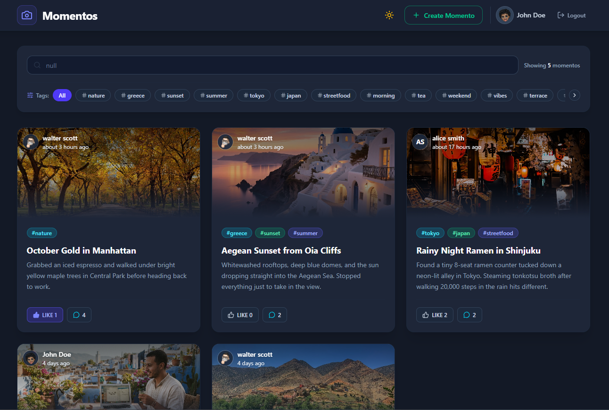
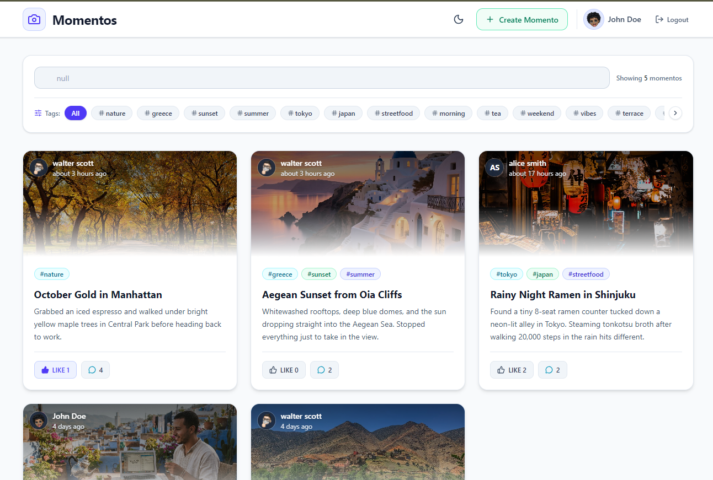
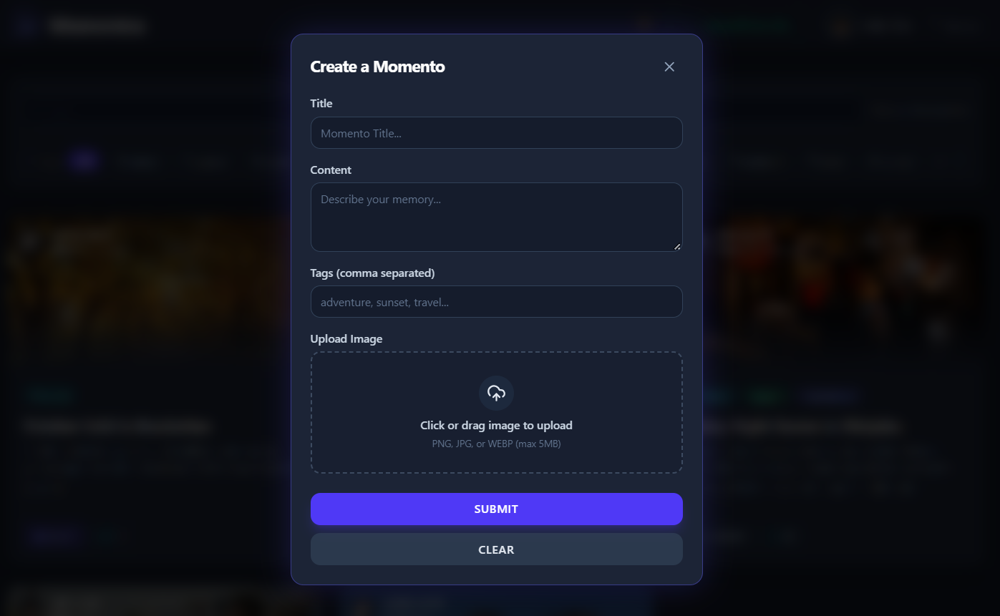
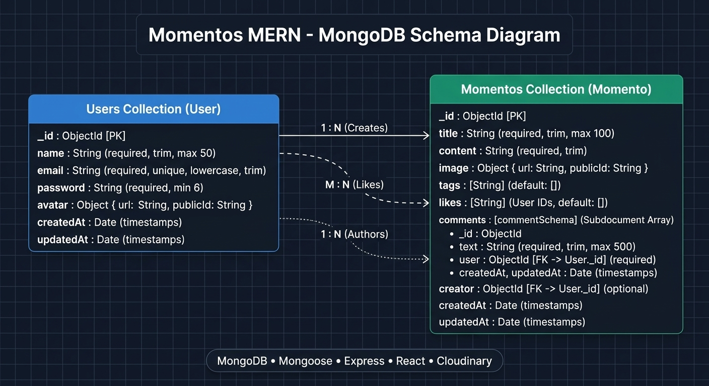

# Momentos — Full-Stack MERN Social Memory App
A full-stack social web application for capturing, sharing, and exploring personal moments with image uploads, interactive likes, comments, real-time search/tag filtering, and user profiles.

## Screenshots

| Home Feed | Light / Dark Theme | Create Momento Form |
| :---: | :---: | :---: |
|  |  |  |

## Database Schema

<p align="center">
  
</p>

## Features

- **Authentication & Role-Aware Access:** JWT-based registration and login with public guest browsing and protected actions (create, like, comment, edit, delete).
- **Media Uploads & Management:** Drag-and-drop image uploads powered by Multer and Cloudinary, with automatic cloud cleanup on edit or delete.
- **Interactive Lightbox Viewer:** Full-resolution image inspection with zoom in/out, drag-to-pan, and theater/plain mode.
- **Comments & Likes:** Real-time like toggles and nested user comments with author/owner moderation.
- **Search & Tag Filtering:** Live filtering by title, story content, creator name, or clickable `#tag` pills.
- **User Profiles:** Public creator profiles and private profile editing with custom avatar uploads.

## Tech Stack

- **Frontend:** React, Vite, Tailwind CSS, DaisyUI, Axios, Lucide Icons, React Hot Toast
- **Backend:** Node.js, Express.js, Mongoose, JWT (`jsonwebtoken`), `bcryptjs`, Multer
- **Database & Storage:** MongoDB Atlas, Cloudinary

## Local Setup

1. **Clone the repository**
   ```bash
   git clone https://github.com/ayoubxmahmoud/momentos-mern.git
   cd momentos-mern
   ```

2. **Configure & run the backend**
   ```bash
   cd backend
   npm install
   cp .env.example .env   # Add your MongoDB, JWT, and Cloudinary credentials
   npm run dev
   ```

3. **Configure & run the frontend**
   ```bash
   cd ../frontend
   npm install
   npm run dev
   ```
